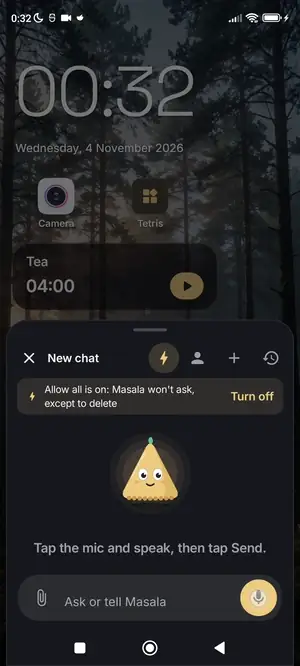
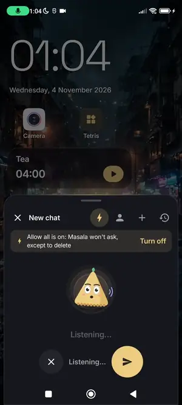
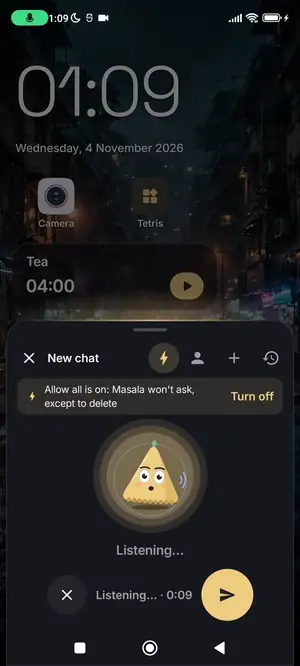
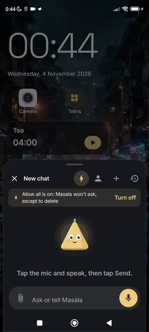
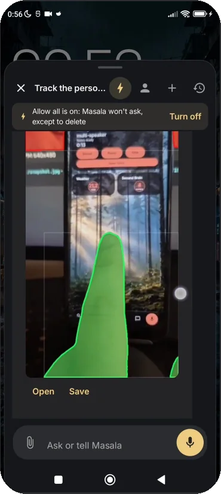

<div align="center">

[](https://samosa-ai.com/masala/)

### Say what you need. Masala rebuilds your home screen around it,<br>and when the app you want doesn't exist, it writes one and pins it to home.


[](LICENSE)

**[⬇️ Download the APK](../../releases/latest)** · **[🌐 Website](https://samosa-ai.com/masala/)** · **[🎮 Play the 317 apps](https://apps.samosa-ai.com/)** · **[🤖 Meet Gotcha](https://samosa-ai.com/gotcha)**

</div>

---

Other launchers rearrange your icons and change the theme. Chatbots tell you how to do something.
Masala changes the phone: ask out loud for a focus morning, a rainy wallpaper or a game about
samosas, and it builds it on your home screen. It asks before it changes anything, and Undo is one tap.

## ✨ A day on the phone

<table>
<tr>
<td align="center" width="25%"></td>
<td align="center" width="25%"></td>
<td align="center" width="25%"></td>
<td align="center" width="25%"></td>
</tr>
<tr>
<td align="center"><b>Home by voice</b><br><sub>“A rainy Mumbai street at night”: painted by Muse Image and set in 30 s</sub></td>
<td align="center"><b>AI inside the apps it writes</b><br><sub>A sticker maker in 74 s. Image draws, SAM cuts out. No API key inside</sub></td>
<td align="center"><b>A game from one sentence</b><br><sub>89 s from the spoken request to slicing samosas. Ask again to change it</sub></td>
<td align="center"><b>It can see</b><br><sub>Attach a photo, say “cut out the coffee mug”: SAM 3.1 returns a real mask. It tracks people through video too (181 of 181 frames)</sub></td>
</tr>
</table>

<sub>Real phone, looping clips cut for length. Waits are sped up where the on-screen label says so; the timers count real seconds.</sub>

**And more:** a live camera from your network as a home widget · meetings transcribed with who said
what · a Second Brain where every memory is a note you can read and edit · modes for morning, focus,
evening and quiet night · an app drawer with grid, list and globe views.

## 🧠 Seven Meta models run the phone

| Model | What it does in Masala |
|---|---|
| **Muse Spark 1.3** | The agent: 107 tools, apps and layouts |
| **Muse Spark Open 1026** | Wrote all 317 apps in the built-in store |
| **Muse Wonder** | Builds apps; top score in our test (19.75 / 20) |
| **Muse Voice Transcribe 1.0** | Voice commands and speaker-labelled notes |
| **Muse Image 1.0** | Wallpapers, and pictures inside generated apps |
| **SAM 3.1** | Masks in photos and video |
| **Muse Glimmer** | The same agent on open weights, on your own PC |

**Your models, your PC.** Point Masala at open-weight Muse Glimmer in LM Studio on a computer on your
network and the same agent answers from your desk, with no cloud and no API key. Any
OpenAI-compatible provider works too (OpenAI, Anthropic, Gemini, Groq, OpenRouter, Mistral and
others). Masala ships with no account and no key: you paste your own, and it's encrypted on the phone.

## 📦 317 apps, built in

<table><tr>
<td width="62%">

Every one written by Muse Spark Open 1026 from **one request, in a single shot**, with no second pass.
They ship inside Masala as its app store: open them from home, or change one by asking
(“make it harder”, “add a timer”).

- **317 of 317** open with zero errors, network blocked
- **Under 9 MB** for all of them, one offline HTML file each
- **20:02:23** total build time
- **MIT**, and public: [awesome-mobile-apps](https://github.com/samosa-ai-com/awesome-mobile-apps)

**▶️ [Play them in your browser](https://apps.samosa-ai.com/)**

</td>
<td align="center"></td>
</tr></table>

## 🛡️ Built to be trusted

- **It asks first.** Anything that changes your phone asks for confirmation, and is logged.
- **One tap back.** Layouts are versioned and checked on the phone before they apply, with 50 undo steps.
- **Generated apps are sandboxed**, and each new one is test-run before you see it.
- **No Accessibility Service, no root.** The mic listens only while you hold it, and nothing sends on its own.
- **Power tools stay opt-in.** All-files access, a Termux bridge and installing APKs ask for their
  permissions only when you use them.

## 🚀 Get it

1. Download **`Masala-<version>.apk`** from the [latest release](../../releases/latest) on an Android 11+ phone.
2. Install it, then pick Masala as your home app.
3. Open **Settings → Models & keys**, choose a provider and paste your key (or point it at your own PC).

New versions show up in **Settings → About**, with what's new, and install after you confirm.
This is a **preview**: layouts, settings and data may change between versions. See the [changelog](CHANGELOG.md).

---

## 🛠️ For developers

Kotlin · Jetpack Compose (Material 3) · Room · DataStore · WorkManager · Media3. minSdk 30, targetSdk 36.
Agents working on the code start at [`AGENTS.md`](AGENTS.md).

### Technical documentation

**[docs/technical/](docs/technical/README.md)** explains how Masala works, in detail and with links to
the source:

| | |
|---|---|
| [Getting started](docs/technical/getting-started.md) | Build, install, configure a model, try it |
| [Architecture](docs/technical/architecture.md) | Modules, component map, data flow, persistence, design decisions |
| [Layout engine](docs/technical/layout-engine.md) | The layout document, rules, mode overlays, the checker, generation, undo |
| [Agent runtime](docs/technical/agent-runtime.md) | The tool loop, context budgeting, tool scopes, experts, the LLM client |
| [Tool catalog](docs/technical/tool-catalog.md) | All 107 built-in tools with sensitivity and data flags |
| [Safety & permissions](docs/technical/safety-and-permissions.md) | Confirmation gate, audit log, prompt injection, Play/Pro split |
| [Widgets & mini apps](docs/technical/widgets-and-mini-apps.md) | Widgets as data, the HTML sandbox, the Pocket Store |
| [Skills, memory & automation](docs/technical/skills-memory-and-automation.md) | Personas, Skill Hub policy, Second Brain, scheduled runs, MCP |
| [Voice & meetings](docs/technical/voice-and-meetings.md) | Push-to-talk, TTS, hours-long diarised meeting notes |
| [Built on Meta AI](docs/technical/meta-ai.md) | The Meta preset, Muse models, SAM 3.1 segmentation, the mask codec |
| [Engineering quality](docs/technical/engineering-quality.md) | Tests, build checks, CI, performance |
| [FAQ & known limitations](docs/technical/faq.md) | What it doesn't do yet, and why |

### Modules

| Module | What | Builds without the Android SDK |
|---|---|---|
| `core/` | Plain Kotlin: contracts (layout, actions, rules, widgets, modes, skills), rule evaluator, mode overlay merge, layout resolver, migrations, tool and file-access interfaces, Skill Hub install policy, app keys and drawer search. Example files and `layout.schema.json` are in `core/src/main/resources/masala/` | Yes |
| `pro/` | Android library: Play-restricted tools and manifest entries. Depends on `core` only | No |
| `app/` | Android app: the launcher (home, drawer, long-press menu, settings), Room database (schemas in `app/schemas/`) and DataStore settings. Depends on `core` and `pro` | No |

```sh
./gradlew :core:test     # JVM tests, seconds; works anywhere with a JDK 17+
./gradlew assembleDebug  # needs the Android SDK (local.properties sdk.dir or ANDROID_HOME)
./gradlew check          # what CI runs: all tests, the manifest check, lint
```

Without an Android SDK, `settings.gradle.kts` builds `core` only.

<details>
<summary><b>Model endpoint and the debug screen</b></summary>

Model calls go to any OpenAI-compatible endpoint, set in `local.properties` (gitignored,
following a local-config pattern, environment variables win):

```properties
SAMOSA_API_URL=https://…                 # default base URL is $SAMOSA_API_URL/v1/
MASALA_LLM_BASE_URL=http://10.0.2.2:1234/v1/   # optional override, e.g. LM Studio from the emulator
MASALA_LLM_API_KEY=…
MASALA_LLM_MODEL=qwen2.5-14b-instruct
```

Samosa's proxy expects a signed-in user's token as the key, and Masala has no sign-in yet, so a local
server is the easy way to test. Debug builds allow plain HTTP to `10.0.2.2` and `localhost` only.

In debug builds, **Settings → Debug** sends a prompt with every registered tool and shows the raw
responses, tool calls and results. Tools that change something ask first; missing permissions and
special access get a Grant button. A prompt like `/pdf_edit {"operation":"info","input":"…"}` runs one
tool directly, without the model.

Speech-to-text uses the same endpoint unless `MASALA_STT_BASE_URL`, `MASALA_STT_API_KEY` and
`MASALA_STT_MODEL` say otherwise.

Release builds ignore all of the above: they compile in no endpoint, model or key, and people choose a
provider and paste their own key in **Settings → Models & keys**.

</details>

<details>
<summary><b>Manifest check and Play readiness report</b></summary>

`build-logic/` holds a Gradle plugin applied to `app`. Before each
`assemble<Variant>` and with `check`, it:

- fails the build if a permission, service, receiver, provider or `<queries>` package in the merged
  manifest comes from outside `pro` and isn't in [`app/manifest-allowlist.txt`](app/manifest-allowlist.txt);
- writes `build/reports/play-readiness-<variant>.md`: everything `pro` adds, described in
  [`pro/play-readiness.txt`](pro/play-readiness.txt), and the core entries with their reasons;
- fails if `app` imports anything from `pro` other than `ProTools`.

Every line in either list needs a reason after `#`.

</details>

<details>
<summary><b>Releases and in-app updates</b></summary>

Signed APKs are published as [GitHub releases](../../releases) by `.github/workflows/release.yml`:

1. Bump `versionCode` and `versionName` in `app/build.gradle.kts`.
2. Write the release notes under `## [Unreleased]` in [`CHANGELOG.md`](CHANGELOG.md).
3. Push to `main`. The workflow runs CI's checks, builds and verifies the signed APK, tags
   `v<versionName>`, publishes `Masala-<versionName>.apk` (as a pre-release while the version is
   `0.x`) and commits `update.json` and `CHANGELOG.md` (notes moved under the new version).

Release builds read `update.json` from `main`: **Settings → About → Updates** shows the notes and
downloads, verifies (sha256 from `update.json`, links only to this repository's releases) and
installs the update; a background check every 12 hours posts one notification per new version.
Debug and profile builds are signed with another key, so they don't check.

**Actions → Release → Run workflow** with *dry run* on builds and verifies without publishing, and keeps
the APK as a one-day workflow artifact.

The workflow needs these repository settings:

| Name | Kind | Value |
|---|---|---|
| `RELEASE_KEYSTORE_BASE64` | secret | `base64 -w0 <keystore>.jks` |
| `RELEASE_STORE_PASSWORD`, `RELEASE_KEY_ALIAS`, `RELEASE_KEY_PASSWORD` | secrets | the keystore's credentials |
| `RELEASE_CERT_SHA256` | variable | the key's certificate digest (`apksigner verify --print-certs`, or the first dry run prints it) |

Keep the keystore backed up: an APK signed with any other key can't update an installed Masala.
Locally, the same `RELEASE_*` names in `local.properties` sign `./gradlew :app:assembleRelease`;
without them the release APK is unsigned.

</details>

## ⚖️ License

Masala is released under the [GNU Affero General Public License v3.0](LICENSE) (AGPL-3.0).
Copyright © 2026 Samosa AI. Third-party code and fonts, with their licenses, are listed in
[`THIRD_PARTY.md`](THIRD_PARTY.md).

---

<div align="center">

**Built in eight days for the Meta Global AI Developer Hackathon, Startup track.**

Want an AI that uses the apps you already have? Meet its sibling, **[Gotcha](https://github.com/samosa-ai-com/Gotcha)**.

[Website](https://samosa-ai.com/masala/) · [Discord](https://discord.gg/rsgXSpcWNq) · [Discussions](https://github.com/orgs/samosa-ai-com/discussions) · [YouTube](https://www.youtube.com/@Samosa-AI) · [X](https://x.com/SamosaAIcom)

<sub>Made with 🌶️ by <a href="https://samosa-ai.com">Samosa AI</a></sub>

</div>
