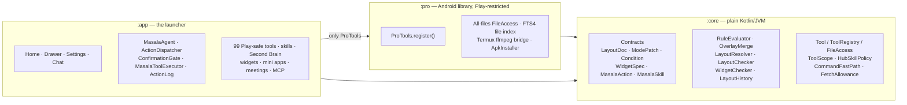
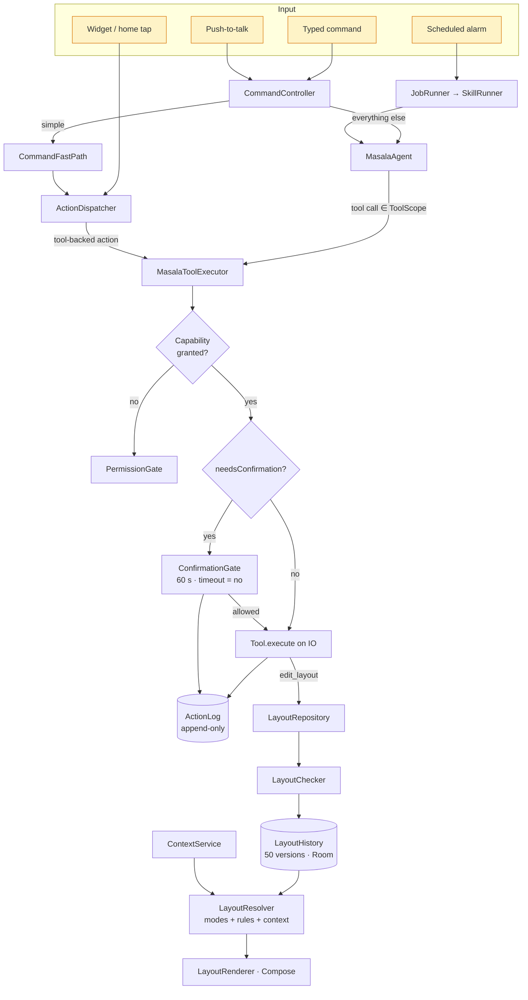
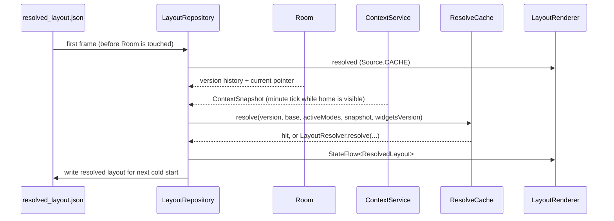
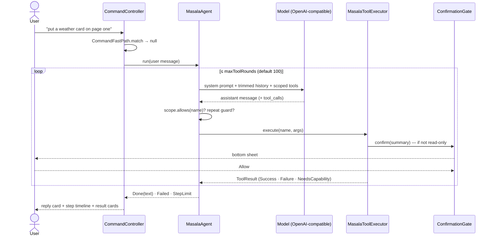

# Architecture

Masala is an Android launcher where the model writes the **data** and the phone does the
**deciding**. Layouts, widgets, modes, rules, skills and scheduled tasks are typed, serialisable
documents. Plain Kotlin checks them, evaluates them, stores them and draws them, so a bad model output
can be rejected, repaired or undone, but it never runs as code.

| | |
|---|---|
| **Language / UI** | Kotlin 2.4, Jetpack Compose (BOM 2026.06), Material 3 |
| **Async** | Kotlin coroutines and `StateFlow`; tools on `Dispatchers.IO`, layout resolution on `Dispatchers.Default` |
| **Serialisation** | kotlinx.serialization 1.11 (strict decoder for model output, lenient for skills) |
| **Networking** | Retrofit 3 + OkHttp 5 (OpenAI-compatible), jsoup for `webfetch` |
| **Persistence** | Room 2.8 + KSP (schemas checked in under `app/schemas/`), DataStore, JSON and Markdown files |
| **Background** | WorkManager (widget HTTP refresh, file index), `AlarmManager` (scheduled runs), foreground services (recording, meetings, jobs) |
| **Media** | Media3 / ExoPlayer (streams), platform `MediaCodec`/`MediaMuxer`, pdfbox-android |
| **SDK** | minSdk 30, target/compile 36, AGP 8.13 |

---

## 1. Modules

| Module | What lives there | Why it is separate |
|---|---|---|
| [`core/`](../../core/) | Every contract, the rule evaluator, overlay merge, layout resolver, checkers, migrations, undo history, the tool interfaces, tool scopes, the Skill Hub policy, app search and ranking, schedule parsing, the meeting and audio maths. | **No Android types.** 418 tests run in seconds on any JVM, and the logic that decides what is allowed is testable without a device. |
| [`pro/`](../../pro/) | All-files `FileAccess`, `list_files`/`read_file`/`write_file`/`edit`/`glob`/`grep`/`file_search`, an FTS4 file index in its own Room database, the Termux `RUN_COMMAND` bridge for ffmpeg (`media_convert`), the `PackageInstaller` APK installer. | Everything Google Play restricts sits here. Its manifest entries go into a readiness report, and `:app` may import exactly one symbol from it: `ProTools`. |
| [`app/`](../../app/) | The launcher (home, drawer, search, long-press, folders), the agent, 99 Play-safe tools, skills, memory, widgets, mini apps, meetings, MCP, settings, onboarding. | Depends on `:core` and `:pro` through `ProTools.register()` only. |
| [`build-logic/`](../../build-logic/) | A Gradle plugin applied to `:app`: the manifest policy, the `:pro` import check, a JDK-21 list-call guard, and the Play readiness report. | It makes the architecture rules fail the build when broken, rather than relying on review. See [Engineering quality](engineering-quality.md). |

---

## 2. Component map

### The composition root

[`MasalaApp`](../../app/src/main/kotlin/com/samosaai/masala/MasalaApp.kt) owns every long-lived
object as a `by lazy` property: the tool registry, the skill registry, the Second Brain, the chat and
consult stores, the MCP store, the layout repository and the context service. Startup order matters
and is explicit in `onCreate`:

1. App catalog → icon cache → launcher model.
2. `ContextService` starts. Wallpaper routines start after it, so their first evaluation sees a
   real snapshot.
3. `LayoutRepository` is built with the catalog, modes, context, widget library, stream sources and
   mini apps.
4. The tools register in this order: `:app` tools, widget tools, `ProTools.register()` (which also
   swaps in all-files access), then the agent tools (`read_layout`, `edit_layout`, `run_skill`,
   `consult_expert`, `question`, …), `search_skills`, the memory tools and the wallpaper routine tools.
   Saved MCP servers register their `mcp_…` tools on top.
5. `ActionDispatcher` is created with the gate and the executor.
6. Scheduled tasks are rescheduled, because a force-stop drops alarms but the store keeps the tasks.

The registry refuses duplicate names (`DefaultToolRegistry.register` → `require`), so two modules
can't silently shadow each other's tool.

---

## 3. The two hot paths

### 3.1 Drawing home

- **Cold start draws at once.** The last resolved layout is a small JSON file read before Room
  opens. If it is missing, a minimal Classic layout is drawn. `firstFrame` records which one was used.
- **Resolution is memoised.** [`ResolveCache`](../../core/src/main/kotlin/com/samosaai/masala/core/layout/ResolveCache.kt)
  keys on *(layout version, active patches, snapshot, widget-library version)* and keeps 4 results
  in an LRU, so a recomposition or a context tick that changes nothing the rules read costs nothing.
- **The minute tick only runs while home is visible.** Charging, Bluetooth and notification
  changes come in through runtime receivers. The context service never sets alarms; only
  background work (DND, modes, reminders, scheduled skills) does.

### 3.2 Answering a request

The full loop is described in [Agent runtime](agent-runtime.md).

---

## 4. Persistence

| Store | What | Where |
|---|---|---|
| Room `MasalaDatabase` (v13, 19 tables) | `layout_versions`, `widgets` + `widget_versions`, `widget_state`, `widget_http_values`, `stream_sources`, `mini_apps`, `skill_runs`, `skill_artifacts`, `app_overrides`, `app_launches`, `usage_weights`, `wallpapers`, `wallpaper_routines`, `watches`, `wiki_pages` (legacy), `meeting_sessions`, `meeting_chunks`, `meeting_turns` … | [`data/MasalaDatabase.kt`](../../app/src/main/kotlin/com/samosaai/masala/data/MasalaDatabase.kt); exported schemas in [`app/schemas/`](../../app/schemas/) |
| Room `ProDatabase` | FTS4 index of shared-storage files (`path` and `modified` not indexed) | [`pro/data/ProDatabase.kt`](../../pro/src/main/kotlin/com/samosaai/masala/pro/data/ProDatabase.kt) |
| DataStore | Launcher settings, the AI profile (endpoints, voice, limits), encrypted keys | `data/LauncherSettings.kt`, `llm/AiSettingsStore.kt` |
| Files (`filesDir`) | One JSON per chat and per consult, skill-run transcripts (one file per run, because a 2 MB+ row can't be read back), the Second Brain vault, meeting audio chunks, `action_log.txt`, `resolved_layout.json` | `chat/`, `skills/TranscriptFiles.kt`, `secondbrain/` |
| SharedPreferences | Small pointers: current layout version, HTTP host approvals per widget, MCP servers, scheduled tasks | various `*Store.kt` |

**Why files for chats and transcripts?** Tool replies can be large (a file listing, a page of HTML).
SQLite cursors fail on rows over about 2 MB, so the database keeps only the last answer (what a
widget shows) and the full transcript lives in a file
([`SkillRunner`](../../app/src/main/kotlin/com/samosaai/masala/skills/SkillRunner.kt)).

---

## 5. Key design decisions

- **The model writes documents, not code.** Layouts, widgets, rules and modes are sealed Kotlin
  types with `@SerialName` discriminators. The strict decoder rejects unknown fields, and the
  checkers enforce what a schema can't (installed apps, unique ids, size ranges, URL secrets).
- **Code-defined tools.** Every tool's name, schema, sensitivity and data flags are compiled in. The
  model can't introduce a tool or raise its own permissions. A call to a name outside the run's
  `ToolScope` is refused even if the model invents it.
- **Ask per tool, not per action type.** `MasalaAction.RunTool` inherits the tool's sensitivity, and
  an unknown tool counts as `DESTRUCTIVE`
  ([`Action.kt`](../../core/src/main/kotlin/com/samosaai/masala/core/contract/Action.kt)).
- **Never send on the user's behalf.** `Dial` and `ComposeMessage` only pre-fill; the user presses
  call or send. `share_file` opens the share sheet. `add_contact` opens the Contacts app pre-filled.
- **Modes are patches, not copies.** A mode adds and hides by id on top of the base layout, so
  editing the base layout never forks into N stale copies. See [Layout engine](layout-engine.md).
- **Everything undoable.** 50 labelled layout versions, memory writes with undo, versioned widgets
  (`widget_versions`).
- **Fail closed, report clearly.** A missing permission returns `NeedsCapability` rather than an
  exception, and the model is told to finish without it. Overlay conflicts and missing widgets are
  reported, not thrown. A rule reading a signal the phone doesn't have evaluates to false.
- **`:core` is pure.** No Android in the logic that decides what is allowed, so it is fully unit
  tested and reusable (the same contracts can back a desktop or web preview).
