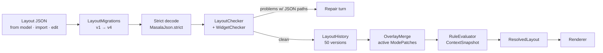
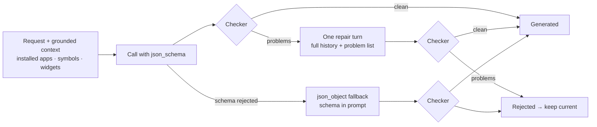

# Layout engine

The layout engine is the core of Masala. It is why a model can redesign your home screen and you
can still trust the result. A home screen is a **document**: typed, versioned, checked, merged with
modes, evaluated against live context, and kept in an undo history. All of the logic is plain Kotlin
in `:core` with no Android dependencies.



---

## 1. The document

A [`LayoutDoc`](../../core/src/main/kotlin/com/samosaai/masala/core/contract/Layout.kt) is
**pages → sections → items**. Every page, section, item and cell has a stable string `id`. Ids are
what modes, rules and edits refer to, so they never change when content moves.

| Section `type` | Holds | Notes |
|---|---|---|
| `header` | clock, date | Toggle each one. |
| `grid` | items | `columns` 1–6, optional title. |
| `list` | items | Vertical list. |
| `group` | items | A labelled group with an icon. |
| `dock` | items | The pinned bottom row (at most 6). Masala has no separate dock concept. |
| `widget` | one library widget `ref` | Since schema 3 it points into the widget library; an inline `widget` is read for one schema. |
| `stack` | up to 8 widget `refs` | Shown one at a time, ordered by rule priority, then tap weight. |
| `html` | a mini-app id | A live, sandboxed WebView at widget size, at most 2 per page. |
| `skill_widget` | a skill id | A skill's own card (`small`/`medium`/`large`). |
| `cells` | `Cell`s with `x, y, w, h` | A launcher grid where icons and widgets share rows. Added in schema 4. |

An [`Item`](../../core/src/main/kotlin/com/samosaai/masala/core/contract/Layout.kt) is a label, an
icon and an action. It doesn't have to be an app: "Gym" can be a `set_alarm` with a symbol icon.
Icons are `app` (package, activity, user profile serial), `symbol` (a bundled Material Symbol plus a
palette tint) or `override` (a generated or picked icon).

Actions are the closed set in [`MasalaAction`](../../core/src/main/kotlin/com/samosaai/masala/core/contract/Action.kt):
`launch_app`, `launch_shortcut`, `open_url`, `dial`, `compose_message`, `set_alarm`, `start_timer`,
`open_drawer`, `expand_notifications`, `search`, `ask_masala`, `set_mode`, `run_skill`,
`refresh_widget`, `flip`, `open_settings`, `play_sound`, `open_mini_app`, `run_tool`,
`meeting_start`/`toggle`/`stop`, `open_meeting`, and `open_folder` (a folder is an action that
holds items).

### A small example

```json
{
  "schemaVersion": 4,
  "pages": [{
    "id": "home",
    "sections": [
      { "type": "header", "id": "top" },
      { "type": "widget", "id": "next-meeting", "ref": { "widgetId": "calendar-card" },
        "rules": [{ "condition": { "type": "minutes_to_next_event", "maxMinutes": 60 },
                    "effect": { "type": "show" } }] },
      { "type": "grid", "id": "work", "columns": 4, "items": [
        { "id": "mail", "label": "Mail",
          "icon": { "type": "app", "packageName": "com.google.android.gm" },
          "action": { "type": "launch_app", "packageName": "com.google.android.gm" },
          "rules": [{ "condition": { "type": "time_window", "start": "18:00", "end": "08:00" },
                      "effect": { "type": "hide" } }] }
      ]},
      { "type": "dock", "id": "dock", "items": [] }
    ]
  }]
}
```

---

## 2. Rules: one condition language

[`Condition`](../../core/src/main/kotlin/com/samosaai/masala/core/contract/Condition.kt) is the one
language used by modes, widget visibility and size, stack order and calendar cards. The model writes
conditions, and [`RuleEvaluator`](../../core/src/main/kotlin/com/samosaai/masala/core/rules/RuleEvaluator.kt)
runs them on the phone on every render and context change. It is **pure and offline**.

| Condition | Reads | Notes |
|---|---|---|
| `time_window` | clock | `"HH:mm"`; a window that ends before it starts runs past midnight. `days` are the days the window **starts** on, so a Friday 22:30–07:00 window is still on at 02:00 on Saturday. |
| `minutes_to_next_event` | calendar | `minMinutes..maxMinutes` until the next event. |
| `charging` | battery | |
| `bluetooth_connected` | BT | A named device (case-insensitive) or any device. |
| `mode_active` | modes | |
| `urgent_count` | notifications | `atLeast` |
| `sleep` | Health Connect | last night, hours, `minHours`/`maxHours` |
| `steps` | Health Connect | today |
| `weather` | Open-Meteo | `kinds` (clear, cloudy, rain, snow, storm, fog) and a °C range |
| `all` / `any` / `not` | — | Combinators, nested freely. |

**A signal the phone doesn't have is false.** No calendar permission means `minutes_to_next_event`
never fires. It doesn't throw, and it doesn't guess.

**Effects** are `show`, `hide`, `size(rows)` and `priority(value)`. When several rules match,
`resolve()` combines them deterministically:

- visibility: the **last** matching `show`/`hide` wins (shown by default);
- size: the **largest** matching `size`, clamped to the widget's `SizeRange`;
- priority: the **highest** matching value (default 0), used to order stacks.

## 3. Context

[`ContextSnapshot`](../../core/src/main/kotlin/com/samosaai/masala/core/contract/ContextSnapshot.kt)
holds every signal the rules can read at one moment: `now`, the next events, calendar access,
charging, battery %, Bluetooth devices, active modes, urgent count, sleep, steps and weather.
[`ContextService`](../../app/src/main/kotlin/com/samosaai/masala/context/ContextService.kt) builds it
from runtime receivers plus a minute tick that runs only while home is visible. Null means
"unavailable" and is kept distinct from "zero".

The debug **Context panel** can override any field
([`ContextOverride`](../../core/src/main/kotlin/com/samosaai/masala/core/contract/ContextOverride.kt)),
so a demo can jump to "Friday 23:00, charging, headphones connected" and watch home rearrange.

---

## 4. Modes are overlays

A [`ModePatch`](../../core/src/main/kotlin/com/samosaai/masala/core/contract/ModePatch.kt) is a
**small patch on the base layout, not a copy of it**: `addSections`, `addItems`, `hideSections`,
`hideItems`, an optional DND policy (`priority`/`alarms`/`none`, with urgent pass-through), and a
trigger (`manual`, or `rule` with any `Condition`).

[`OverlayMerge`](../../core/src/main/kotlin/com/samosaai/masala/core/layout/OverlayMerge.kt) applies
active patches in a fixed order (`order`, then `id`). Within one patch, **adds run before hides**.
Ids are stable, so a later patch can hide what an earlier one added.

- An add into a `cells` grid takes the first free cell (`CellGrid.add`). `after` has no meaning there.
- A hidden cell **leaves its spot empty**, so nothing else shifts while a mode is on, and nothing
  jumps when it turns off.
- Anything that can't be applied (unknown page or section, duplicate id, a section that can't hold
  items) is **skipped and reported** as a `Conflict`. The merge never throws, so a stale mode can't
  break home.

Because modes are patches, editing the base layout (or letting the AI redesign it) automatically
carries into every mode. There are no N copies to drift apart.

## 5. Resolution

[`LayoutResolver.resolve(base, activeModes, ctx, widgets)`](../../core/src/main/kotlin/com/samosaai/masala/core/layout/LayoutResolver.kt)
produces exactly what the renderer draws:

1. Merge the active modes.
2. Drop pages, sections, items and cells whose rules say hidden.
3. Look up each widget `ref` in the widget library. A missing widget is dropped and listed in
   `missingWidgets` rather than crashing.
4. Compute each widget placement's row height: the rule `size` effect, else the placement's
   `rowsOverride`, else the widget's default, always clamped to its range.
5. Sort stacks by rule priority (a stable sort, so ties keep their order). An empty stack disappears.
6. Inline the resolved widget specs, so the renderer never needs the library.

The result is memoised by `ResolveCache` (see [Architecture § 3.1](architecture.md#31-drawing-home)).

---

## 6. The checker

[`LayoutChecker`](../../core/src/main/kotlin/com/samosaai/masala/core/layout/LayoutChecker.kt)
(504 lines) runs **before anything is saved, imported or shown**. It does two things:

1. **Parse.** It migrates, then strictly decodes. If decoding fails, it returns one problem with
   the JSON path where the decoder stopped. The parser re-decodes from text after migrating,
   because a tree decoder can't report positions.
2. **Check** what a schema can't express, against an `Environment` describing *this* phone:
   installed apps per user profile, skill ids, known symbols, tool names, mode ids, the widget
   library, stream sources and mini-app ids.

Every problem has a path, for example `$.pages[0].sections[1].items[2].action: com.foo is not
installed for user 0`. The model is told exactly what to fix.

| Limit | Value |
|---|---|
| Pages | 8 |
| Sections per page | 24 |
| Items per section | 48 (dock: 6) |
| Grid columns | 1–6 |
| Cell-grid rows | 64 |
| Widgets in a stack | 8 |
| HTML widgets per page | 2 (each one is a live WebView) |
| Declared widget rows per page | 8 |
| Widget height | 1 ≤ min ≤ default ≤ max ≤ 8 |
| Folder | 1–16 items, label ≤ 60 chars, no nested folders, no rules inside |

Other checks include duplicate ids (reported with the path of the first use), overlapping cells,
cells outside the grid, icon cells that aren't 1×1, invalid alarm and timer values, non-phone
numbers, non-HTTP URLs, unknown modes, skills, tools, mini apps and settings pages, inverted ranges
in conditions, and `size` effects outside a widget. Every widget in a layout also goes through
[`WidgetChecker`](../../core/src/main/kotlin/com/samosaai/masala/core/widgets/WidgetChecker.kt).

### Guarding against a wipe

A model that never read the current home can submit a small, valid layout that deletes everything.
[`LayoutLoss`](../../core/src/main/kotlin/com/samosaai/masala/core/layout/LayoutLoss.kt) compares
before and after by **what things open** (an app's action, a widget's id), not by item id, so
renaming ids isn't mistaken for deleting. If the new layout keeps less than half of a home that
has at least 3 things, `edit_layout` refuses unless the call says `replace_all`:

> *Not applied: this layout keeps only 2 of the 14 apps and widgets on home. Call read_layout, …*

---

## 7. Generating a home from a sentence or a photo

[`LayoutGenerator`](../../app/src/main/kotlin/com/samosaai/masala/layout/LayoutGenerator.kt) turns
text, optionally with a photo of a home screen you like, into a validated layout:



- **Structured output first.** [`LayoutSchema`](../../app/src/main/kotlin/com/samosaai/masala/layout/LayoutSchema.kt)
  builds a strict-mode JSON Schema: every property is required, `additionalProperties: false`, and
  unions use `anyOf`. Symbol names are an `enum`, which is a cheap way to stop the model inventing
  icons. The generator may only use **eight safe actions**: `launch_app`, `open_url`, `set_alarm`,
  `start_timer`, `open_drawer`, `ask_masala`, `run_skill`, `open_mini_app`. No dialling, messaging,
  modes or raw tools.
- **One repair turn** with the full history, so the model still sees the photo. If the reply was cut
  off mid-JSON, the repair prompt says so explicitly, because otherwise the model truncates again.
- **Never applies a failure.** Transport errors give `Failed`, checker errors give `Rejected`, and
  only a clean document gives `Generated`. The caller saves it as a new labelled version.
- **Revise mode** sends the current document in the system prompt and asks for the complete revised
  layout.

Inside a chat, the agent uses the same checker through `read_layout` (capped at 40k chars) and
`edit_layout`. On failure, the first 10 problems go back to the model.

---

## 8. History and undo

[`LayoutHistory`](../../core/src/main/kotlin/com/samosaai/masala/core/layout/LayoutHistory.kt) keeps
**at most 50 labelled versions**, dropping the oldest first. A change made after an undo drops the
redo branch, as in any editor. Versions can be renamed, deleted or jumped to. "Reset to Classic" is
itself a new version, so even a reset can be undone. The pure history returns a `Change` (what to
save, what to delete), and [`LayoutRepository`](../../app/src/main/kotlin/com/samosaai/masala/layout/LayoutRepository.kt)
persists it to Room under a mutex.

## 9. Migrations

[`LayoutMigrations`](../../core/src/main/kotlin/com/samosaai/masala/core/migration/LayoutMigrations.kt)
upgrades saved and imported JSON one step at a time, up to `CURRENT_SCHEMA_VERSION = 4`. A newer
document is refused rather than silently misread.

| Version | Added | Data step |
|---|---|---|
| 2 | folders (`open_folder`) | none |
| 3 | widget library refs | [`WidgetLift`](../../core/src/main/kotlin/com/samosaai/masala/core/migration/WidgetLift.kt) moves inline widgets into the library when one is available |
| 4 | `cells` grids | [`CellLift`](../../core/src/main/kotlin/com/samosaai/masala/core/migration/CellLift.kt) folds widget sections into a cell grid, sized from the library |

The JSON steps are no-ops for v2–v4 on purpose: older documents stay valid, and the semantic
"lifts" run in the repository, where the widget library is available to size things.

## 10. Tests

All of the above is covered by `:core` unit tests: `RuleEvaluatorTest`, `OverlayAndResolverTest`,
`LayoutCheckerTest`, `LayoutHistoryTest`, `MigrationAndPolicyTest`, `ResolveCacheTest`,
`LayoutSchemaTest`, and in `layout/` `CellGridTest`, `CellOverlayTest`, `CellLiftTest`,
`CellEditsTest`, `LayoutEditsTest`, `LayoutLossTest`. They run in seconds with no device:
`./gradlew :core:test`. On device, `ClassicHomeRenderTest`, `WidgetRenderTest` and `HtmlWidgetTest`
check the renderer.
