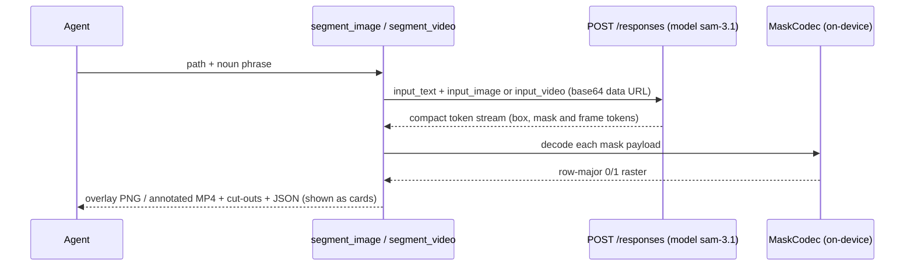

# Built on Meta AI

Masala works with any model, but Meta's stack is a first-class path through it. With one Meta key,
the same host serves chat, image generation, speech-to-text, and **SAM 3.1** image and video
segmentation. Masala also includes a byte-exact Kotlin port of Meta's SAM mask decoder, so
segmentation masks are decoded and drawn **on the phone**.

| Capability | Meta model | Masala surface |
|---|---|---|
| Chat + tool calling | `muse-spark-1.3` (preset default) | The agent loop, experts, layout and widget generation |
| Image generation | `muse-image-1.0` (preset default) | `generate_image`, `generate_wallpaper`, the mini-app media bridge |
| Speech-to-text | `muse-voice-transcribe-*` (classified automatically) | Push-to-talk, `transcribe_file`, meetings with diarisation |
| Segmentation | `sam-3.1` via the Responses API | `segment_image`, `segment_video`, mini-app `masala://media/segment` |
| Open-weight models | Llama and others via LM Studio / Ollama | The same agent, with keyless LAN presets and a 900 s timeout |

---

## 1. The Meta preset

[`ProviderPresets.Meta`](../../core/src/main/kotlin/com/samosaai/masala/core/ai/ProviderPreset.kt):

```kotlin
ProviderPreset("meta", "Meta", "Me", "https://api.meta.ai/v1/", KeyKind.KEY,
    Capabilities(chat = true, voiceIn = true, voiceOut = false, image = true),
    defaultChatModel = "muse-spark-1.3", defaultImageModel = "muse-image-1.0")
```

- **One key, four roles.** When the chat host offers image models, image generation uses the same
  host and key automatically ([`AiSettingsStore`](../../app/src/main/kotlin/com/samosaai/masala/llm/AiSettingsStore.kt)).
- **Model discovery.** `GET /models` is classified by the server's `task` hint first, then by name
  ([`AiConnection`](../../app/src/main/kotlin/com/samosaai/masala/llm/AiConnection.kt),
  [`AudioModels`](../../app/src/main/kotlin/com/samosaai/masala/audio/AudioModels.kt)).
  `muse-voice-transcribe-1.0` must be classified as speech-to-text, not as a TTS "voice" model.
  Classifying it as TTS once meant the app never picked a transcription model, so
  `transcribe_file` couldn't work at all. `AudioModelClassifyTest` now pins the classification.
- **Speech.** The STT client uploads WAV to the endpoint in one of three modes: `PUSH_TO_TALK` (one
  transcript), `ENDPOINTING`, or `DIARIZATION` (`turns[]` with speakers). Meetings rely on the last
  one. See [Voice & meetings](voice-and-meetings.md#3-meetings).

## 2. SAM 3.1 segmentation

*"Find the red bicycle in this photo."* *"Track the dog through this video."*



Segmentation is a different model from image generation. It is served as `sam-3.1` on the same
host and key, and the model id is fixed: sending the image model would complete with zero matches,
whereas a wrong host fails loudly
([`SamSegmentTool`](../../app/src/main/kotlin/com/samosaai/masala/tools/SamSegmentTool.kt)).

### Images: `segment_image`

The reply is a compact token format. Each detection is
`<id><|box;x1=…;y1=…;x2=…;y2=…;w=…;h=…|>` followed by a `<|mask;…|>` token carrying the mask
raster's size and its payload. The tool produces:

- an **annotated PNG**: each object's decoded mask painted as a tinted overlay with an edge outline
  (strokes on set pixels that touch unset ones) and a faint box;
- one **transparent cut-out PNG per object** ([`Cutout`](../../app/src/main/kotlin/com/samosaai/masala/tools/sam/Cutout.kt));
- a **JSON summary** of boxes and masks.

A record whose mask fails to decode **falls back to its box**, so the run still produces something.

### Video: `segment_video`

[`SegmentVideoTool`](../../app/src/main/kotlin/com/samosaai/masala/tools/SegmentVideoTool.kt) sends
the clip and the phrase. The reply groups detections by frame (`<0f>…<1f>…`), tracking the object
across the frames the API samples (8 by default, at most 16). Masala then:

- extracts the frames with `MediaMetadataRetriever`, burns in masks and boxes, and **encodes an
  annotated MP4 with platform `MediaCodec` + `MediaMuxer`** (AVC, long side ≤ 720 px, 5–15 fps, no
  audio). There is **no ffmpeg and no new dependency or permission**, so it is Play-safe;
- writes a **JSON sidecar** with per-frame boxes;
- keeps one decoded bitmap alive at a time and recycles every one;
- falls back to a contact-sheet PNG (3 frames) if encoding fails, and says so.

**Memory budget.** The video is inlined as base64, which costs roughly three copies in memory (bytes,
encoded string, JSON body). The cap of **12 MB** keeps the peak around 50 MB on a phone heap. Longer
clips are refused with advice to trim them first (`media_edit` can).

## 3. The mask codec: a byte-exact port

SAM masks arrive compressed. [`MaskCodec`](../../app/src/main/kotlin/com/samosaai/masala/tools/sam/MaskCodec.kt)
is a Kotlin port of the decoder in Meta's `meta-sam-parser` (`_mask_codec.py`, SAM License; see
[`THIRD_PARTY.md`](../../THIRD_PARTY.md)):

- a **custom base85 alphabet**, 5-char prefix;
- an **adaptive binary range coder** with spatial and context modelling;
- **Paeth-style predictors** for the lossless format (`~…` payloads);
- a **12-bit neighbourhood context model** for the `one_bit` format (`!…` payloads);
- strict errors (`MaskDecodeException`) for malformed, truncated or non-canonical payloads.

One detail needed care. The Python reference rescales its adaptive counters with
`(x >> 1) or 1`, where `or` is Python's *logical* or: halve, but keep 1 instead of 0. Read as a
bitwise OR, it would set the low bit and silently corrupt the models once any counter rescales. The
port encodes this as `halveGuarded()` and documents it at the three call sites.

**Validated byte-for-byte.** `MaskCodecTest` checks the port against golden vectors from the Python
reference, which must match exactly. `SamRecordsTest`, `CutoutTest`, `SamSegmentToolTest` and
`SegmentVideoToolTest` (21 tests: frame-time maths, wire parsing, size and MIME helpers) cover the
rest. The parsing and maths are deliberately free of Android imports so they run as plain JVM tests.

## 4. Segmentation inside generated apps

A mini app the user allowed media for can call
`fetch('masala://media/segment?ref=…&prompt=…')` and get back a data-URL cut-out
([`MiniAppMediaBridge`](../../app/src/main/kotlin/com/samosaai/masala/miniapps/MiniAppMediaBridge.kt)).
The host runs the same `SamSegmentTool`, and the API key never enters the page's JavaScript. A
generated "sticker maker" or "remove the background" app gets SAM without ever holding a credential.

## 5. Open-weight models on your own machine

Masala's agent loop is built so that **local open-weight models** (Llama and others served by LM
Studio or Ollama) are usable, not just tolerated:

| Problem with local servers | Masala's handling |
|---|---|
| Rejects `{"type":"object"}` without `properties` (HTTP 400 for the whole request) | Always adds `properties: {}` ([`withProperties`](../../app/src/main/kotlin/com/samosaai/masala/agent/AgentModel.kt)) |
| Prints tool calls as `<tool_call><function=…>` text | Parsed into real tool calls ([`LLMClient.normalizeResponse`](../../app/src/main/kotlin/com/samosaai/masala/llm/LLMClient.kt)) |
| Emits `<think>…</think>` reasoning inline | Moved to `reasoningContent`, removed from the reply |
| Slow, unstreamed replies (a 30B model writing a full app) | 900 s read timeout for LAN hosts instead of 180 s |
| Malformed JSON arguments | Repaired before storing and sending, so one bad call can't 400 every later turn |
| No key | No `Authorization` header at all |
| Re-reads a ~20k-token prompt on every step | Consults get 900 s instead of 180 s; the tool-schema size is subtracted from the context budget before history is trimmed |
