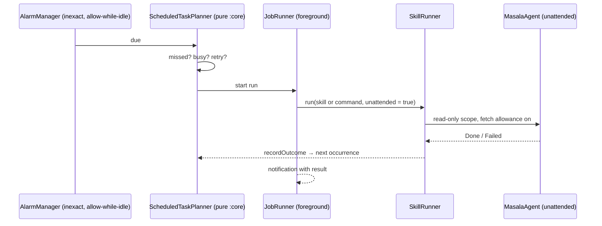

# Skills, memory & automation

This page covers the parts that make Masala more than a chat box: **skills and personas** (reusable
expertise), the **Second Brain** (memory you can read and edit), **scheduled runs** (work that
happens while you sleep), and **MCP connectors** (tools from your own servers).

---

## 1. Skills

A skill is a JSON document, [`MasalaSkill`](../../core/src/main/kotlin/com/samosaai/masala/core/contract/MasalaSkill.kt).
It uses the shared skill format (`id`, `title`, `description`, `instructions`, `requiresTools`,
`keywords`, `targetPackageNames`) plus optional Masala fields that older readers ignore:

| Field | Meaning |
|---|---|
| `platforms` | Must include `masala` for a hub install (empty = legacy, extra checks apply) |
| `tier` | `free` / `pro` |
| `persona` | A `systemPrompt`, conversation `starters`, a `disclaimer`, and **`whenToUse`**: the routing line the main agent sees |
| `widget` | A home card: icon, tint, inputs (`text`, `photo`, `video`, `audio_file`, `document`, `folder`, `path`, `record_audio`), output kind (`markdown`, `file`, `audio`, `video`, `mini_app`, `installed_app`) |
| `schedule` | A default like `"daily 07:30"`, parsed by [`SkillScheduleParser`](../../core/src/main/kotlin/com/samosaai/masala/core/scheduled/SkillScheduleParser.kt) into a scheduled task the user can change |

### Bundled skills

[`app/src/main/assets/skills/`](../../app/src/main/assets/skills/):

| Id | Kind | Tools it declares |
|---|---|---|
| `chef` | persona | — |
| `doctor` | persona (with disclaimer) | — |
| `editor` | persona | — |
| `fitness_coach` | persona: Training planner | — |
| `handyman` | persona | — |
| `researcher` | persona | — |
| `travel_planner` | persona | — |
| `software_engineer` | persona: **builds and changes mini apps** | — |
| `widget_maker` | persona: **makes and changes widgets** | `list_widgets`, `read_widget`, `widget_schema`, `create_widget`, `update_widget`, `place_widget`, `remove_widget`, `delete_widget`, `list_stream_sources`, `add_stream_source`, `test_stream` |
| `daily_brief` | scheduled job, `daily 07:30` | `list_calendar_events`, `weather`, `websearch`, `webfetch` |

Users can edit personas (Settings → Personas), import community skills, and switch individual tools
off per expert.

### How a skill runs

[`SkillRunner`](../../app/src/main/kotlin/com/samosaai/masala/skills/SkillRunner.kt) creates a
`skill_runs` row and a `MasalaAgent` with the persona and skill instructions and the skill's
[`ToolScope`](agent-runtime.md#3-tool-scopes-least-privilege-per-run). It streams events to the
sheet and saves the transcript **after every turn**, one file per run, because a database row over
about 2 MB can't be read back. Files the run produced are recorded as `skill_artifacts`. Runs are
app-scoped, so closing the sheet doesn't stop them, and the skill's widget shows the last answer.

- **`runData`.** Data gathered *before* the model starts (the daily brief's calendar and weather)
  is put in front of the first message as a hidden block that is saved with the transcript.
- **`fallback`.** If the model fails on the first turn, code writes the answer. The daily brief
  renders calendar and weather without the news
  ([`BriefFallback`](../../core/src/main/kotlin/com/samosaai/masala/core/brief/BriefText.kt)), so
  the morning card is never empty. The error is still saved.

### Finding skills

The system prompt lists up to 30 installed skills. `search_skills` searches the rest by keyword or
package name ([`SkillMatching`](../../core/src/main/kotlin/com/samosaai/masala/core/tool/SkillMatching.kt)).
The Skill Hub install policy is described in
[Safety § 5](safety-and-permissions.md#5-third-party-skills-skill-hub-policy).

---

## 2. Experts in chat

Personas are both standalone chats and **tools for the main agent** (`consult_expert`). See
[Agent runtime § 6](agent-runtime.md#6-experts-consult-as-a-tool). In short, the main agent consults
up to 10 experts per chat, each for up to 10 exchanges. An expert runs on its own prompt without
seeing the chat and without opening screens. The main agent writes the final answer in its own voice
and keeps any safety instruction word for word.

---

## 3. Second Brain

The Second Brain is Masala's long-term memory. It is a **folder of Markdown files** rather than a
vector store, so the user can read, edit, export and diff it, and the model navigates it the way a
person would.

```
SOUL.md        identity: how Masala should be with this user (always in the prompt, ≤ 1,500 chars)
MEMORY.md      the map: what lives where (always in the prompt, ≤ 1,500 chars)
user.md        profile from settings (≤ 800 chars)
areas/         life areas (work, health, home…)
people/        one card per person
notes/         dated notes: what was true then, never rewritten
raw/           originals: recordings, PDFs, photos (copied ≤ 200 MB; files > 10 MB on durable storage are linked in place)
```

Records carry YAML front matter (`title`, `area`, `type`, `updated`) and link to each other with
`[[wiki links]]`. The app draws the result as a 3D graph
([`SecondBrainGraph`](../../app/src/main/kotlin/com/samosaai/masala/ui/secondbrain/SecondBrainGraph.kt)).

**How the agent uses it**
([`SecondBrainStore`](../../app/src/main/kotlin/com/samosaai/masala/secondbrain/SecondBrainStore.kt),
[`MemoryTools`](../../app/src/main/kotlin/com/samosaai/masala/agent/MemoryTools.kt)):

1. The prompt carries `SOUL.md`, `MEMORY.md`, the profile and up to 50 entry titles. Each is capped,
   with a truncation note, so a huge file can never stall a run.
2. The agent opens detail files only when the task needs them: `memory_read path` or
   `memory_search` (grep-like `path:line: text`).
3. **Before its first write in a run** it reads `memory_read PROTOCOL`, the full rules
   ([`MemoryProtocol`](../../app/src/main/kotlin/com/samosaai/masala/secondbrain/MemoryProtocol.kt)).
   The system prompt only carries the short version.
4. **Writes apply at once, with Undo.** `memory_write` and `memory_edit` don't open the gate. The
   chat shows a "remembered" card (up to 5) with Undo, and an undo journal keeps the last
   50 changes, the same depth as the layout history. Rewriting a **dated note** does ask, and `memory_delete` is destructive.
5. **One fact in one place.** Search before creating, update rather than duplicate. Writes go
   through `importPage`/`upsertByTitle`, so every record has valid front matter.
6. **Only what the user said.** Memory from emails, notifications, files or web pages is refused by
   rule, and passwords, codes and keys are never stored.

Scheduled tasks and notes can be **linked both ways** (`memory_link_task`): the task remembers its
note, and the note's `task_ref` names the task. The two sides are set and cleared together.

---

## 4. Scheduled runs

`schedule_agent_task` (which asks) lets the agent set up work for later: *"Every weekday at 7:30,
summarise my calendar and the weather."*



- **Model.** A [`ScheduledTask`](../../core/src/main/kotlin/com/samosaai/masala/core/scheduled/ScheduledTask.kt)
  has a prompt, an optional skill, a start time and a `Repeat` (`NONE`, `HOURLY`, `DAILY`, `WEEKLY`
  with ISO weekdays, `MONTHLY`, which falls back to the last day of shorter months), retries (default
  1), and its run history.
- **Planning is pure Kotlin.** [`ScheduledTaskPlanner`](../../core/src/main/kotlin/com/samosaai/masala/core/scheduled/ScheduledTaskPlanner.kt)
  decides the next occurrence, whether a firing was **missed** (the phone was asleep well past the
  time), and what to do when another run holds Masala: re-check every 2 minutes and give up after an
  hour as `SKIPPED_BUSY`. One scheduled run at a time.
- **Inexact alarms** (`setAndAllowWhileIdle`). Masala doesn't ask for `SCHEDULE_EXACT_ALARM`,
  which Play allows only for alarm and calendar apps. Tasks are re-armed after reboot and after a
  force-stop.
- **Foreground job.** [`JobRunner`](../../app/src/main/kotlin/com/samosaai/masala/jobs/JobRunner.kt)
  runs the work in the foreground with a progress notification, so a run that takes minutes isn't
  killed.
- **Unattended scope.** The run gets the skill's scope intersected with **read-only tools that open
  no screen**, minus `search_skills` (a scheduled run does its own skill), `sleep` (it would hold
  the worker) and `get_location` (background location needs a Play declaration).
  `webfetch` may only open this run's search results
  ([Agent runtime § 4](agent-runtime.md#4-unattended-runs-and-exfiltration)).
- **Outcomes** are recorded per run: done, failed, cancelled, missed, skipped busy, blocked (Android
  refused, so a notification asks for a tap), not started.

### Wallpaper routines

`set_wallpaper_routine` saves an ordered rule list (the first match wins) that changes the wallpaper
on its own. It is evaluated by the pure
[`RoutineEvaluator`](../../core/src/main/kotlin/com/samosaai/masala/core/wallpaper/RoutineEvaluator.kt)
against the same context snapshot, and checked by `RoutineChecker`. A manual wallpaper change
releases the routine's last decision, so the next trigger decides again.

---

## 5. MCP connectors

Settings → Connected tools adds your own **Model Context Protocol** servers. Their tools join the
registry as `mcp_<server>__<tool>`.

[`McpHttpClient`](../../app/src/main/kotlin/com/samosaai/masala/connectors/mcp/McpHttpClient.kt)
implements the **Streamable HTTP** transport (MCP 2025-06-18):

- `initialize` → `notifications/initialized` → `tools/list` (paginated via `nextCursor`) →
  `tools/call`;
- keeps `Mcp-Session-Id` and the negotiated `MCP-Protocol-Version`, and opens a new session once if
  the server returns 404;
- reads `text/event-stream` replies event by event and stops at the matching response id, so a
  stream the server keeps open can't hang the call. Reply size is capped as bytes arrive;
- **redirects are followed only when they can't leak a token**: same origin, or http→https on the
  same host. Anything else fails, naming the target, so the user can add it explicitly;
- timeouts: connect 15 s, read 60 s, call 90 s;
- the old HTTP+SSE transport is detected and reported. Stdio servers are out of scope on a phone.

Every MCP tool is `CHANGES_SOMETHING` and `usesNetwork`, so **it always asks**. A server is capped at
64 tools, and schemas are normalised to object schemas. Sending a token or header over plain HTTP to
a non-local host shows a warning.
