# Voice & meetings

Masala can listen in three ways: a short **push-to-talk** command, the **assist gesture** over any
app, and a **meeting recording** that runs for hours. It speaks back through the phone's voice or an
API voice. The signal-processing parts (VAD maths, level normalisation, WAV splitting, speaker
stitching) are pure Kotlin in `:core`, so they are unit-tested without a microphone.

---

## 1. Speech in

Voice in is its own choice in the [`AiProfile`](../../core/src/main/kotlin/com/samosaai/masala/core/ai/AiProfile.kt):

| Provider | How | End of speech |
|---|---|---|
| **On this phone** (null endpoint) | Android `SpeechRecognizer` ([`AndroidTranscriber`](../../app/src/main/kotlin/com/samosaai/masala/audio/AndroidTranscriber.kt)) | The recogniser decides |
| **API** (Meta, OpenAI, Groq, Speaches, Custom) | Masala records, converts to WAV and uploads a multipart request to the configured endpoint ([`AudioApi`](../../app/src/main/kotlin/com/samosaai/masala/audio/AudioApi.kt)) | Masala's own [`SilenceDetector`](../../app/src/main/kotlin/com/samosaai/masala/audio/SilenceDetector.kt) |

**Mic modes:** *tap* (a take ends on a pause, hands-free) or *hold* (hold to talk). Hands-free
defaults to on for API endpoints, which Masala times itself, and off for the phone's recogniser,
which would flicker the mic between segments.

### The voice-activity detector

[`SilenceDetector`](../../app/src/main/kotlin/com/samosaai/masala/audio/SilenceDetector.kt) gets
one RMS (dBFS) value per audio window:

- **Noise floor = the minimum over a rolling 12-window history**, recorded only *before* speech is
  accepted. A minimum, unlike a percentile, can only be dragged up by a pause-free shout, and
  sustained speech never moves the floor mid-sentence.
- **Speech** = a window above `floor + 10 dB` (and never below −50 dBFS), held for **3 consecutive
  windows**, so a cough or door slam is ignored.
- **Short commands don't wait for priming.** "open YouTube" (~1.2 s) can be accepted early from
  level variation (≥ 6 dB). Steady ambient noise, however loud, never counts.
- **Stop** after the trailing-silence timeout. The clock starts only after real speech, so a slow
  starter isn't cut off. If nobody speaks, it stops after 15 s.

### Cleaning the transcript

Before a spoken turn is sent:

1. [`NameCorrector`](../../core/src/main/kotlin/com/samosaai/masala/core/agent/NameCorrector.kt)
   fixes misheard names against app labels, modes and skill titles, but only when exactly one known
   name is clearly closest.
2. [`TranscriptCleaner`](../../app/src/main/kotlin/com/samosaai/masala/agent/TranscriptCleaner.kt)
   makes one model call (temperature 0) that fixes grammar, punctuation and capitalisation **in the
   language that was spoken**. The dictation is wrapped in tags and labelled as not being a question,
   so "what's the weather" comes back as itself rather than as an answer. It never throws, and the
   raw text is the fallback.
3. [`CommandFastPath`](../../core/src/main/kotlin/com/samosaai/masala/core/agent/CommandFastPath.kt)
   handles "timer 5 minutes" without a model call.

### The assist gesture

When Masala is the phone's assistant app, long-pressing home (or the corner swipe) opens
[`AssistActivity`](../../app/src/main/kotlin/com/samosaai/masala/agent/AssistActivity.kt): the same
reply card as on home, drawn over whatever is on screen, with its own confirmation sheet.

## 2. Speech out

[`TtsEngine`](../../app/src/main/kotlin/com/samosaai/masala/audio/TtsEngine.kt) has two providers:
Android `TextToSpeech`, or an OpenAI-compatible `/audio/speech` endpoint (e.g. `tts-1` with the
`alloy` … `shimmer` voices). Speed is 0.5–2.0×. All text headed for a voice goes through
[`SpeechTextSanitizer`](../../app/src/main/kotlin/com/samosaai/masala/audio/SpeechTextSanitizer.kt)
(Markdown, links and symbols made speakable). The on-screen text is never altered. `speak_text`
also saves the audio file.

---

## 3. Meetings

A meeting recording has to survive hours of recording, a killed process, and an endpoint that caps
each request at ten minutes.

```mermaid
flowchart LR
  MIC[Mic · foreground service<br/>microphone type] --> CH[AAC chunk<br/>every 5 min]
  CH --> DEC[Decode → 16 kHz mono WAV]
  DEC --> ENH[PcmEnhancer<br/>DC · HPF 85 Hz · gate · median norm · limiter]
  ENH --> OV[Prepend previous chunk's tail<br/>overlap anchor]
  OV --> ASR[Upload · mode DIARIZATION<br/>3 attempts · 150 s]
  ASR --> SL[SpeakerLabels<br/>stitch A/B across windows]
  SL --> DB[(meeting_turns)]
  DB --> MAP[Map: 12k-char windows<br/>3 in parallel]
  MAP --> RED[Reduce: one structured note]
  RED --> OUT[Second Brain · share · reminder]
```

### Recording

[`MeetingRecorderService`](../../app/src/main/kotlin/com/samosaai/masala/meetings/MeetingRecorderService.kt)
is one `microphone` foreground service with one session row, writing **one AAC file per 5 minutes**
into `files/meetings/<id>/`. Chunking is what makes a three-hour meeting safe:

- each piece stays under the transcriber's ten-minute request limit;
- a killed process loses **at most the open chunk**;
- closed chunks are transcribed **while the meeting continues**.

Pause closes the current file and resume opens the next, so paused time is silence rather than
audio, and the elapsed clock excludes the gap. The notification's chronometer uses the same numbers
as the screen. Android 14+ forbids starting a microphone foreground service from a background widget
tap, so `meeting_start` opens the meeting screen when the app isn't in front.

Imported audio goes through the same pipeline:
[`WavSplitter`](../../core/src/main/kotlin/com/samosaai/masala/core/audio/WavSplitter.kt) streams a
decoded WAV into the same 5-minute windows. An hour at 16 kHz is 115 MB on disk and must never
become a 230 MB array.

### Cleaning the audio

[`PcmEnhancer`](../../core/src/main/kotlin/com/samosaai/masala/core/audio/PcmEnhancer.kt) exists
because, on a phone lying on a table three metres away, **level** is what fails first:

1. DC-offset removal;
2. a 2nd-order **high-pass at 85 Hz** (HVAC rumble, table bumps);
3. a frame gate (20 ms frames): frames below the noise floor + 6 dB are attenuated to 0.35×, **not
   muted**, so pauses stay natural;
4. **median** level normalisation to −20 dBFS (max +24 dB). A median rather than a peak, so one
   cough doesn't set the gain;
5. a limiter at −1 dBFS so the gain can't clip.

This is level and rumble work, not model-based denoising, and the UI says so.

### Transcribing and stitching speakers

[`MeetingTranscriber`](../../app/src/main/kotlin/com/samosaai/masala/meetings/MeetingTranscriber.kt)
uploads each chunk with `mode = DIARIZATION`, which returns `turns[]` of *(text, startMs, endMs,
speaker)*. Each request is retried up to 3 times with a 150 s timeout. The work is **idempotent**:
re-transcribing a chunk replaces its turns without duplicating anything.

The endpoint labels speakers **per request**, always calling the first voice `A`.
[`SpeakerLabels`](../../core/src/main/kotlin/com/samosaai/masala/core/audio/SpeakerLabels.kt) stitches
them: each window is uploaded with the previous chunk's tail in front, and the **words in that
overlap** are the anchor. If `A` said a sentence at the end of window 1 and `B` says the same words at
the start of window 2, then `B` here is `A` there. An overlap that is too thin or ambiguous comes back
`uncertain`, and the UI says so rather than guessing silently.

### Writing the note

[`MeetingNotesWriter`](../../app/src/main/kotlin/com/samosaai/masala/meetings/MeetingNotesWriter.kt)
uses two passes:

- **Map.** The transcript is cut at turn boundaries into windows of about 12,000 chars. Each window
  is asked for topics, decisions, action items and questions, **3 windows at a time**. A failed
  window is recorded and skipped, so a three-hour meeting still produces a note.
- **Reduce.** The window extractions, the user's own rough notes and their bookmarks become one
  structured [`MeetingNote`](../../core/src/main/kotlin/com/samosaai/masala/core/meeting/MeetingNote.kt).
  The Markdown is rendered **locally**, so every note has the same shape and the action checkboxes
  stay Masala's. If the reduce fails, the merged windows are used instead.

[`MeetingExport`](../../app/src/main/kotlin/com/samosaai/masala/meetings/MeetingExport.kt) saves the
note to the Second Brain (`type: meeting`), shares it, or turns an action item into a reminder
through chat. The **meeting widget** binding (`status`, `title`, `elapsed`, `speakers`, `summary`)
and the `meeting_start`/`toggle`/`stop` actions put the controls on home.
