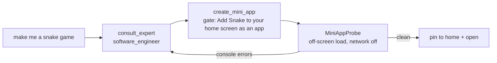

# Widgets & mini apps

Masala can make two kinds of things for your home screen, and they deliberately have different
trust models:

| | **Generated widget** | **Mini app** |
|---|---|---|
| What the model writes | A JSON **spec** (data) | A single HTML file (code) |
| Who draws it | Masala's native Compose renderer | A sandboxed WebView |
| Can run code? | **No.** 16 fixed component types | Yes, JavaScript in a jail |
| Reads phone data? | Through named **bindings** only | **Never.** No bridge, no files |
| Network | Only hosts you approved for that widget | **Off** by default, per-app toggle |
| Checked by | [`WidgetChecker`](../../core/src/main/kotlin/com/samosaai/masala/core/widgets/WidgetChecker.kt) (48 distinct checks) | Off-screen probe for console errors |
| Expert who makes it | **Widget Maker** | **Software engineer** |

---

## 1. Widgets are data

A [`WidgetSpec`](../../core/src/main/kotlin/com/samosaai/masala/core/contract/Widget.kt) is an id,
a title, a list of components drawn top to bottom, a `SizeRange` (rows 1–8 and grid width), and
rules (the same [condition language](layout-engine.md#2-rules-one-condition-language) as layouts).
Styling is bounded to a palette tint, a size emphasis and an alignment. **No free colours or fonts.**

| Component | Purpose |
|---|---|
| `text` | Fixed text or a bound value |
| `counter` | Tap to count; resets `daily`/`weekly`/`monthly` |
| `checklist` | Ticks (≤ 20) that reset on a schedule |
| `timer` | Countdown that **rings even when home isn't visible**; can chain (`autoStartKey`) for Pomodoro |
| `progress` | Amount vs goal, with resets |
| `chart` | `bar` / `line` over ≤ 31 days |
| `button` | Runs a `MasalaAction` (gated per tool; `run_tool` limited to `toggle_torch`, `toggle_wifi`, `set_timer`) |
| `image` | A symbol or app icon |
| `list` | ≤ 8 rows from a binding (next events, watches) |
| `gauge` | Ring for a numeric value against a max |
| `globe` | A slowly turning wireframe globe with a value in the middle |
| `row` / `column` | Layout, nesting at most 2 deep, ≤ 4 children |
| `video` | A live stream (at most 1 per widget) |
| `snapshot` | A still from a stream, refreshed every ≥ 2 s |
| `web_value` | A labelled number from an HTTP JSON endpoint |

**Bindings** are where values come from: `storage` (the widget's own state), `next_event`,
`battery`, `media`, `sleep`, `steps`, `weather`, `urgent_count`, `http`, `stream_status`,
`skill_result` (a skill's last run), `second_brain` (`notes`, `latest`) and `meeting` (`status`,
`title`, `elapsed`, `speakers`, `summary`). A widget can't read anything that isn't on this list.

### The widget library

Widgets live in a **library** ([`WidgetLibrary`](../../app/src/main/kotlin/com/samosaai/masala/widgets/WidgetLibrary.kt)),
and layouts point at them with `{ "widgetId": …, "rowsOverride": … }`. One widget can sit on two
pages at two heights. Each widget keeps its **last 20 versions** in `widget_versions`. The library's
`version` counter is part of the resolve-cache key, so editing a widget redraws home without changing
the layout. **33 bundled templates**
([`core/src/main/resources/masala/widgets/`](../../core/src/main/resources/masala/widgets/))
seed an empty library: pomodoro, water, habits, budget, stock and crypto tickers, rain soon, step
globe, sleep last night, next meeting, two cameras, meeting notes, second brain, and more.

### Making a widget

[`WidgetGenerator`](../../app/src/main/kotlin/com/samosaai/masala/widgets/WidgetGenerator.kt) follows
the same pattern as the layout generator: **structured output → `WidgetChecker` → one repair turn
→ keep nothing on failure.** `create_widget` accepts either a full spec or one sentence. It refuses
near-duplicates ("A similar widget already exists… offer to use it") and **saves to the library
without asking**, because nothing appears on home until `place_widget`, which always asks.

### Web values

`http` bindings and `web_value` read a JSON endpoint with a `$.a.b[0].c` path
([`JsonPick`](../../core/src/main/kotlin/com/samosaai/masala/core/widgets/JsonPick.kt)).

- **Per-host approval.** On placement, the user approves each host for *that widget*, with a line
  such as *"Fetch api.example.com every 300s while shown."* A changed host asks again
  ([`HttpApproval`](../../app/src/main/kotlin/com/samosaai/masala/widgets/HttpApproval.kt)).
- **Rate limits** from the checker: on-screen refresh ≥ 30 s; background refresh ≥ 15 min through
  [`WidgetHttpWorker`](../../app/src/main/kotlin/com/samosaai/masala/widgets/WidgetHttpWorker.kt)
  (WorkManager). A failure keeps the last value with its age.
- **No secrets, no templates** in URLs (see [Safety § 6](safety-and-permissions.md#6-secrets-and-privacy)),
  so a URL can never be filled with private values.
- A `refresh_widget` button refetches **only already-approved hosts**, so it never asks.

### Cameras and streams

`add_stream_source` stores RTSP, HLS, DASH, progressive MP4, MJPEG or snapshot-JPEG sources, with
credentials sealed in the Keystore and kept out of the URL. `test_stream` connects for up to 8 s and
reports the codec, resolution and latency. On home,
[`PlayerPool`](../../app/src/main/kotlin/com/samosaai/masala/widgets/media/PlayerPool.kt) keeps
**two** muted ExoPlayers (LRU). A third visible video falls back to snapshots, with a *Live* button
that takes the least recently used slot.

---

## 2. Mini apps

A mini app is a self-contained HTML file (inline CSS and JS, at most 200,000 chars) stored in
`mini_apps`. It opens full screen or sits on home as an `html` section (at most 2 per page, since each
is a live WebView). The model never writes one directly in chat. The main agent consults the
**Software engineer** expert, which knows the rules and calls `create_mini_app`.



- **Repair loop with real errors.** [`MiniAppProbe`](../../app/src/main/kotlin/com/samosaai/masala/miniapps/MiniAppProbe.kt)
  loads new HTML once, **off screen**, with the network off and a throwaway origin (its storage is
  wiped afterwards). The tool reply includes the console errors, so the model can fix them in the same
  run. `update_mini_app` returns the new version's errors and any the old one logged.
- **Over-long HTML is refused, not cut.** Cutting mid-script would ship a broken app and hide the
  reason.
- **Opening is de-duplicated** ([`MiniAppOpenGuard`](../../app/src/main/kotlin/com/samosaai/masala/miniapps/MiniAppOpenGuard.kt)),
  so the tool's open and the reply's open don't stack two identical activities.

## 3. The sandbox

[`MiniAppView`](../../app/src/main/kotlin/com/samosaai/masala/miniapps/MiniAppView.kt) sets up every
app the same way. The probe uses the same code, so what the probe checks is what the user runs.

| Layer | Setting |
|---|---|
| JS bridge | **None.** No `addJavascriptInterface`. |
| Files | `allowFileAccess`, `allowContentAccess`, file-URL access: **all false** |
| Origin | Each app gets its **own origin** under `appassets.androidplatform.net`, so `localStorage` isn't shared between apps |
| Host assets | Nothing from Masala's own assets is reachable |
| Navigation | Never leaves the app, network on or off |
| Mixed content | `MIXED_CONTENT_NEVER_ALLOW` |
| Network **off** (default) | `blockNetworkLoads`; `shouldInterceptRequest` refuses every other request (each blocked host is logged once to the console); a **CSP** header stops WebSockets and form POSTs, which the request hook never sees |
| WebRTC | **Removed** with network off: a document-start script strips `RTCPeerConnection` from every frame. Each window also strips its child frames (an `about:blank` iframe gets no start script and brings fresh globals). Builtins are captured first, so an app that overrides `forEach`/`apply`/`defineProperty` can't turn it off. `MiniAppNetworkTest` tries each way around this. |

### Media bridge (opt-in)

An app can't hold keys or reach the model. When the user allows media for that app,
[`MiniAppMediaBridge`](../../app/src/main/kotlin/com/samosaai/masala/miniapps/MiniAppMediaBridge.kt)
exposes a few **host-proxied** calls:

```js
fetch('masala://media/generate?prompt=a+red+fox')   // → {ok, ref, dataUrl}
fetch('masala://media/segment?ref=…&prompt=fox')    // → SAM cut-out
fetch('masala://media/speak?text=Hello')            // → plays on the phone
fetch('masala://media/capabilities')
```

WebView's `fetch` rejects custom schemes before they reach the interceptor, so a shim rewrites them
to a same-origin path. The host runs the same tools chat uses (`GenerateImageTool`,
`SamSegmentTool`, `SpeakTool`), and **the API key never enters the JS context.**

## 4. The Pocket Store

[`PocketStore`](../../app/src/main/kotlin/com/samosaai/masala/ui/miniapps/PocketStore.kt) ships
**317 offline mini apps** in [`app/src/main/assets/miniapps/`](../../app/src/main/assets/miniapps/):
25 apps (tools, health, home, money: a breathing pacer, sleep sounds, …) and 292 games across 20
groups (puzzle 52, arcade 39, learning quests 29, sports 22, quiz 16, strategy 15, simulation 15, …).
They run in the same sandbox as generated apps, can be pinned to home, and work with the network off.

## 5. APK export (Pro)

In `:pro`, [`ApkInstaller`](../../pro/src/main/kotlin/com/samosaai/masala/pro/install/ApkInstaller.kt)
installs an exported app through a `PackageInstaller` session, and a non-exported receiver reports
the status. It needs `REQUEST_INSTALL_PACKAGES`, which is why it lives in the restricted module.
